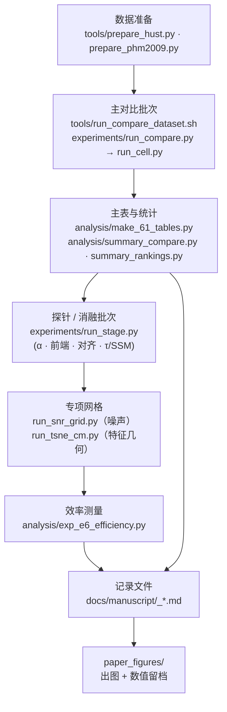

# AG-Mamba 定稿实验脚本包（`paper_experiments/`）

按**手稿定稿口径**归集的全部实验脚本：训练入口、摘要脚本、一次性探针、批次启动器、体检工具。
仓库里的原文件**未移动、未改动**——本包是"最小镜像"，仓库始终是唯一权威。

- 逐文件清单（49 行）：[`MANIFEST.csv`](MANIFEST.csv)
- 被排除的 v0.2 遗留脚本与理由：[`EXCLUDED.md`](EXCLUDED.md)
- **姊妹包**：[`../paper_figures/`](../paper_figures/) —— 出图脚本 + 数值留档 + 图件。

> **校验状态（2026-10-03 建包时）**：包内 **49/49** 个文件与仓库对应文件 **sha1 逐字节一致**；
> 35 个 `.py` 全部可被解析（无语法错误）。脚本一律 `shutil.copyfile` 二进制拷贝，未做过任何文本改写。

---

## 1. 两个包的分工

```
        paper_experiments/  ← 本包：把「训练日志」变成「数值记录」
        ----------------------
  数据 ──► 训练入口（experiments/）──► results*/ 日志
                                        │
                                        ▼
                            摘要脚本（analysis/）──► 记录文件 docs/manuscript/_*.md
                                        │
        paper_figures/  ◄───────────────┘
        ---------------
        出图脚本（analysis/make_fig*.py）──► figures/*.pdf|png
```

- **本包回答**：这些数字是**怎么跑出来、怎么算出来**的。
- **`paper_figures/` 回答**：这些图是**怎么画出来**的，以及画图读的是哪几个数值文件。
- 唯一重叠文件：`experiments/run_tsne_cm.py`（§6.8，训练与出图合一）。两包各存一份同源拷贝，
  仓库 `experiments/run_tsne_cm.py` 是唯一权威。

---

## 2. 流水线总览



批次**必须串行**：两条流并行会互抢同一块 GPU，实测各慢约 2 倍（`logs/wait_then_*.sh` 就是为此写的排队器）。

---

## 3. 逐脚本说明

### 3.1 `experiments/` —— 入口（会真的跑训练）

| 脚本 | 职责 | 产物 |
|---|---|---|
| `run_cell.py` | 单元格执行器：建模 → 训练 → **每 epoch 评估一次**（完整单元恒 60 个点）。定义 `TASKS` / `DATA_LENGTH` / `METHOD_MODULES` / `make_config` | `results/**/*.log` |
| `run_compare.py` | 主对比批次驱动：21 方法 × 任务 × 种子；**跳过条件要求满 60 个评估点**（完整性闸门）；`write_summary` 落盘 | `docs/manuscript/_cmp_<DS>.md` / `.csv`、`logs/progress_<DS>.txt` |
| `run_stage.py` | 阶段注册表（`STAGES` / `GROUPS`）：所有探针与消融批次都在这里定义 | `results_probe_*/**` |
| `run_snr_grid.py` | SNR 噪声网格：**训练干净、测试加噪**（5 个 loader 一次交给 `train_model`，直接取 5 列精度，不解析各方法日志） | `logs/_s66_snr.json` |
| `run_tsne_cm.py` | 特征几何：t-SNE + 混淆矩阵 + 源/目标线性可分性；基座直读 `agmamba/configs.yaml`，对照臂 = 首层随机核 | `results_geom/`、`weights_geom/`、`_s68_geom.md` |

`run_stage.py` 里**定稿用到的 stage 名**（其余是 v0.2 时期的）：

```
alias_sweep_clean        # §6.3 α 扫描      → results_probe_alpha
align_ablate_clean       # §6.4 对齐四臂    → results_probe_align
tau_ssm_ablate_clean     # §6.4 τ/SSM 四臂  → results_probe_tau
frontend_ablate_clean    # §6.3 前端六臂    → results_probe_front
```

### 3.2 `analysis/` —— 摘要与记录（把日志变成记录文件）

分三层。**第 1 层是原语，其余都直读 `results*/`，不读中间报表**。

**① 原语层**

| 脚本 | 职责 |
|---|---|
| `make_all_methods_report.py` | `read_series` / `READOUTS`(last5/last1/last10/peak) / `SEEDS` / `EPOCHS` 的定义处；CLI 只打印不落盘 |

**② 主对比层**

| 脚本 | 产物 | 手稿 |
|---|---|---|
| `make_61_tables.py` | `_<ds>_tables.md` | §6.1 Table 1/2、§6.7 Table 9 |
| `summary_compare.py` | `_cmp_<DS>_stats.md`（配对 Wilcoxon） | §6.1 Table 4、§6.2、§6.7 |
| `summary_rankings.py` | `_cmp_<DS>_rankings.md`（排序 + 三基准 cross 矩阵） | §6.1–§6.2 |

**③ 探针层**

| 脚本 | 产物 | 手稿 |
|---|---|---|
| `summary_alpha_sweep.py` | `_s63_alpha.md` | §6.3 Table 5 |
| `summary_front_ablate.py` | `_s63_front.md` | §6.3 Table 6 |
| `summary_align_ablate.py` | `_s64_align.md` | §6.4 Table 7 |
| `summary_tau_ssm_ablate.py` | `_s65_tau_ssm.md` | §6.4 Table 7、附录 B |
| `exp_s65_dilation.py` | `_s65_dilation.md` + `figures/_s65_dilation.npz` | §6.5 Fig 8 |
| `summary_snr.py` | `_s66_snr.md` | §6.6 Table 8b |
| `exp_e6_efficiency.py` | `_s66_efficiency.md` | §6.6 Table 8、§4.3 |

**④ 研究层（口径依据）**

| 脚本 | 产物 | 手稿 |
|---|---|---|
| `readout_window_study.py` | `_readout_window_study.md` | §5.4（k=5 的依据）、附录 A |
| `summary_nondet.py` | `_repro_floor.md`（**best-epoch 口径**的可复现底噪 2.55 / 6.00） | §5.3 |

> `summary_nondet.py` 是"底噪"的来源，虽然它比的是同名臂的重复运行，读的是 best-epoch；
> 正文已把它声明为其它读数的**保守上界**，不要把它当成 last5 口径。

### 3.3 `logs/` —— 一次性探针与启动器

**探针**（多为"跑一次、把结论写进正文"的脚本，多数只打印 stdout）：

| 脚本 | 回答的问题 | 手稿 |
|---|---|---|
| `_ssm_scan_facts.py` | 两扫描后端前向一致到 fp32；官方 CUDA 反传不可逐位复现；纯 PyTorch 分块扫描两次差为精确 0 | §4.3 |
| `_s63_plane.py` | 各前端臂的 (ζ, Π) 定位（`import` fig2 的度量模块保证同源） | §6.3 |
| `_preflight_front_arms.py` | 各臂可训练参数量与前端输出形状 | §6.3 Table 6 |
| `_check_fr_lap_pairing.py` | `fr_lap` 是否 **RNG 中性**（→ 该臂可用于配对检验） | §6.3 |
| `_check_front_init.py` | `front_init` 语义（未知取值回落到 `gabor`） | §6.3 |
| `_s65_accuracy_probe.py` | 冻结 / 可训练 / 未训练三臂 + 核组审计（`extra` 模式出冻结臂 T0/T4 剖面） | §6.5 |
| `_s65_ladder2.py` | 带限精确膨胀阶梯（训练腿，落盘 `_s65_model_trained.pt`） | §6.5 |
| `_s65_ladder2_eval.py` | 阶梯的**评测腿**（复用权重，免重训；改图/改口径时只重跑这一个） | §6.5 |
| `_verify_dgnis_pu.py` | DGNIS 头数修复后的 PU 回归验证（RNG 消耗量保持不变） | §5.5 |
| `_verify_fix.py` | `datasets_src` / 批大小两处修复的回归验证 | §5.5 |
| `_smoke_alpha.py` | α=2.0 臂应**逐点等于**主对比 `pub` 臂（配置同源自检） | §6.3 |
| `_regen_figures_wsl.sh` | 用**规范解释器**批量重建 9 个图脚本的产物 | 全篇图件 |

**启动器**（都用 tmux 常驻；`&` / `nohup` 在本工作区活不过 20 s）：

| 脚本 | 作用 |
|---|---|
| `run_front_ablate.sh` | 前端消融批次（会话 `fr`） |
| `run_front_lap.sh` | `fr_lap` 追加臂（等 `fr` 结束） |
| `resume_front.sh` | 前端补漏续跑 + 跑完自动刷新 `_s63_front.md` 与 Fig 6 |
| `run_snr_grid.sh` | SNR 网格（会话 `snr`） |
| `resume_snr.sh` | SNR 续跑 + 自动刷新 `_s66_snr.md` 与 Fig 9d |
| `wait_then_snr.sh` | 串行队列：等 `fr` → SNR |
| `wait_then_geom_snr.sh` | 串行队列：等 `fr` → 特征几何 → SNR |
| `_regen_figures_wsl.sh` | 见上 |

### 3.4 `tools/`

| 脚本 | 职责 |
|---|---|
| `run_compare_dataset.sh` | 主对比一键启动：**内含 `AGM_FORCE_PY_SCAN=1`**，tee 到 `logs/cmp_<DS>.log` |
| `watch_agmamba.sh` | 进度守候：AGMamba 段完成即报警，并列出缺失单元 |
| `resume_hust.sh` | HUST 主对比续跑（DGNIS 头数修复后补 4 方法 × 10 任务） |
| `check_incomplete.py` | 体检：列出半截/空日志与未满 60 点的单元 |
| `check_determinism.py` | 确定性自检：同配置重复运行 + 两扫描后端比对 |
| `detach.sh` | 把"后台化"收进脚本文件，规避命令行里的 `&` 被改写 |
| `prepare_hust.py` / `prepare_phm2009.py` | 数据准备（切窗/选域/重采样） |
| `list_arms.py` / `check_stages.py` | 列出实际存在的臂名 / 校验 stage 注册表 |

### 3.5 `docs/` —— 口径快照

| 文件 | 说明 |
|---|---|
| `COMPARE_PROTOCOL.md` | **唯一权威协议**（含变更记录表；主口径已从 last10 改为 `last5`） |
| `configs.yaml` | 交付模型配置（`agmamba/configs.yaml` 的快照） |

---

## 4. 手稿溯源对照表

| 手稿 | 记录文件 | 生成脚本 | 训练 stage / 批次 | 结果目录 |
|---|---|---|---|---|
| §5.1 数据与任务 | — | `tools/prepare_hust.py`、`prepare_phm2009.py` | — | `datasets/` |
| §5.2 协议 | `COMPARE_PROTOCOL.md` | — | — | — |
| §5.3 可复现下限 | `_repro_floor.md` | `analysis/summary_nondet.py` | `run_stage.py det_ctl*` / `nondet_ctl` | `results/` |
| §5.4 / 附录 A 读数窗口 | `_readout_window_study.md` | `analysis/readout_window_study.py` | 复用主对比 | `results/` |
| §6.1 Table 1/2 | `_<ds>_tables.md` | `analysis/make_61_tables.py` | `tools/run_compare_dataset.sh` | `results/` |
| §6.1 Table 4 / §6.2 | `_cmp_<DS>_stats.md`、`_cmp_<DS>_rankings.md` | `analysis/summary_compare.py`、`summary_rankings.py` | 同上 | `results/` |
| §6.3 Table 5（α 路径） | `_s63_alpha.md` | `analysis/summary_alpha_sweep.py` | `run_stage.py alias_sweep_clean` | `results_probe_alpha/` |
| §6.3 Table 6（前端六臂） | `_s63_front.md` | `analysis/summary_front_ablate.py` | `run_stage.py frontend_ablate_clean` | `results_probe_front/` |
| §6.4 Table 7（对齐四臂） | `_s64_align.md` | `analysis/summary_align_ablate.py` | `run_stage.py align_ablate_clean` | `results_probe_align/` |
| §6.4 Table 7 / 附录 B（τ、SSM） | `_s65_tau_ssm.md` | `analysis/summary_tau_ssm_ablate.py` | `run_stage.py tau_ssm_ablate_clean` | `results_probe_tau/` |
| §6.5 Fig 8（膨胀） | `_s65_dilation.md`、`logs/_s65_accuracy.md`、`logs/_s65_ladder2.md` | `analysis/exp_s65_dilation.py`、`logs/_s65_accuracy_probe.py`、`logs/_s65_ladder2.py` + `_eval.py` | 单种子探针 | `logs/*.npz`、`logs/_s65_model_trained.pt` |
| §6.6 Table 8 / Fig 9（成本） | `_s66_efficiency.md` | `analysis/exp_e6_efficiency.py` | 不训练（前向计时） | — |
| §6.6 Table 8b（噪声） | `_s66_snr.md` | `analysis/summary_snr.py` | `experiments/run_snr_grid.py` | `results_probe_snr/` |
| §6.7 Table 9 / Fig 10（HUST 十任务） | `_hust_tables.md` | `analysis/make_61_tables.py HUST` | `run_compare_dataset.sh HUST` | `results/` |
| §6.8 Fig 11/12（特征几何） | `_s68_geom.md` | `experiments/run_tsne_cm.py` | 自训练 4 个单元 | `results_geom/`、`weights_geom/` |
| §4.3 扫描后端实现注记 | —（写进正文） | `logs/_ssm_scan_facts.py`、`tools/check_determinism.py` | — | — |

---

## 5. 硬约束（违反任一条都会静默出错）

1. **`peak` 一律禁止**。它是 best-epoch 口径，方法间不可比（偏差差 8 倍）。
   它只存在于 `_cmp_<DS>_stats.md` 的归档段里，**不进正文、不进附录、不被任何脚本读**。
2. **解析 `_cmp_*_stats.md` 必须锚定"主口径 `last5`"段**。
   同一个文件里有 4–5 段同样形如「AG-Mamba `unif` vs 各方法」的表（last5 / last1 / last10 / peak）
   ——只按 `unif` + `vs` 两条匹配会让**最后一段（peak）**覆盖主口径，数字会静默错（实测 WhiteningNet 的 Δ 从 +41.42 变成 +35.79）。
3. **跑任何 AG-Mamba 变体臂都要带 `AGM_FORCE_PY_SCAN=1`**。
   官方 `mamba_ssm` CUDA 内核反传含原子累加 → 与主对比不可比（同配置同种子 60 个点里 53 个不同）；
   纯 PyTorch 扫描两次运行差为**精确 0**。
4. **探针臂必须写进隔离目录**：`AGM_RESULTS=<repo>/results_probe_xxx`。
   否则会被 `run_compare.discover_units` 当成新臂扫进 `_cmp_*.md/.csv`。
5. **`PYTHONUTF8=1`**。曾有 `open()` 未指定编码 + 运行期 locale 变成 C 的组合，
   导致读到第 17 次 YAML 时 `UnicodeDecodeError` 崩掉整个 stage（GPU 空闲，极易被误判为"跑完了"）。
6. **完整性闸门**：跳过条件要求**满 60 个评估点**。断电留下的 10–59 点日志曾冒充完成单元。
   随时用 `tools/check_incomplete.py` 体检。
7. **不要写"解析中间报表"的脚本**。所有摘要都直读 `results*/`；
   读 `_s6*_data.md` 这类中间产物会让数字静默出错。
8. **重跑图件用 WSL 规范解释器** `/home/fzg/anaconda3/envs/DSwinTrack/bin/python`。
   用其它解释器会得到"数值相同、字节不同"的文件（LF→CRLF、PNG/PDF 重编码）。
9. **长批次用 tmux 或 `tools/detach.sh`**。`setsid nohup … &` 在本工作区活不过约 20 s。
10. **完整度闸门（摘要层）**：任何有缺失/偏短单元的臂，池化列一律输出 `–`。
    "部分均值 + 脚注"会被读成"容量/臂大胜"（`fr_cap960` 只完成 10/15 时曾算出 94.98 的假象）。

---

## 6. 依赖（本包**不含**，需从仓库取）

| 类别 | 内容 | 说明 |
|---|---|---|
| 代码库 | `agmamba/`、`models/`、`baselines/`、`datasets/`、`utils/` | 本包脚本 `import` 它们；仓库根必须作为工作目录 |
| 数据 | `datasets/`、`datasets/hust_data/`（`hust_x1024.npz` 等） | 由 `tools/prepare_*.py` 生成 |
| 训练日志 | `results/`（约 452 MB / 2364 文件）、`results_probe_*/`、`results_geom/` | 摘要脚本的唯一输入；**未随包** |
| 权重 | `weights_geom/`、`logs/_s65_model_trained.pt` | 特征几何与阶梯复算用 |
| 环境 | Python 3.10 + torch 2.5.1+cu121 + `mamba_ssm` 2.2.4，单卡 | 规范解释器见 §5.8 |

**因此本包不能独立跑训练**——它保证的是"脚本是定稿那一版、且与仓库逐字节相同"。
要在别处跑，请把本包内容覆盖到仓库对应路径（或直接使用仓库）。

---

## 7. 最小复现命令集

```bash
# 0) 规范解释器
PY=/home/fzg/anaconda3/envs/DSwinTrack/bin/python
cd /home/fzg/Fault/AG-Mamba

# 1) 主对比（三基准）
bash tools/run_compare_dataset.sh HUST        # 内含 AGM_FORCE_PY_SCAN=1

# 2) 主表与统计
$PY analysis/make_61_tables.py HUST
$PY analysis/summary_compare.py HUST
$PY analysis/summary_rankings.py

# 3) 探针批次（示例：前端六臂）
AGM_FORCE_PY_SCAN=1 AGM_RESULTS=/home/fzg/Fault/AG-Mamba/results_probe_front \
  PYTHONUTF8=1 $PY -u experiments/run_stage.py frontend_ablate_clean
$PY analysis/summary_front_ablate.py

# 4) 噪声网格
$PY experiments/run_snr_grid.py && $PY analysis/summary_snr.py

# 5) 出图（改到 paper_figures/ 里看）
bash logs/_regen_figures_wsl.sh
```

---

## 8. 目录树

```
paper_experiments/
├── README.md                 本说明
├── MANIFEST.csv              49 行逐脚本清单（分层/职责/产物/手稿位置/字节/sha1）
├── EXCLUDED.md               57 个 v0.2 遗留脚本与排除理由
├── experiments/    (5)       run_cell · run_compare · run_stage · run_snr_grid · run_tsne_cm
├── analysis/      (13)       原语 1 + 主对比 3 + 探针 7 + 研究 2
├── logs/          (19)       探针 11 + 启动器 8
├── tools/         (10)       启动 3 + 体检 5 + 数据 2
└── docs/           (2)       COMPARE_PROTOCOL.md · configs.yaml
```

**合计 49 个文件**（5 + 13 + 19 + 10 + 2）。
